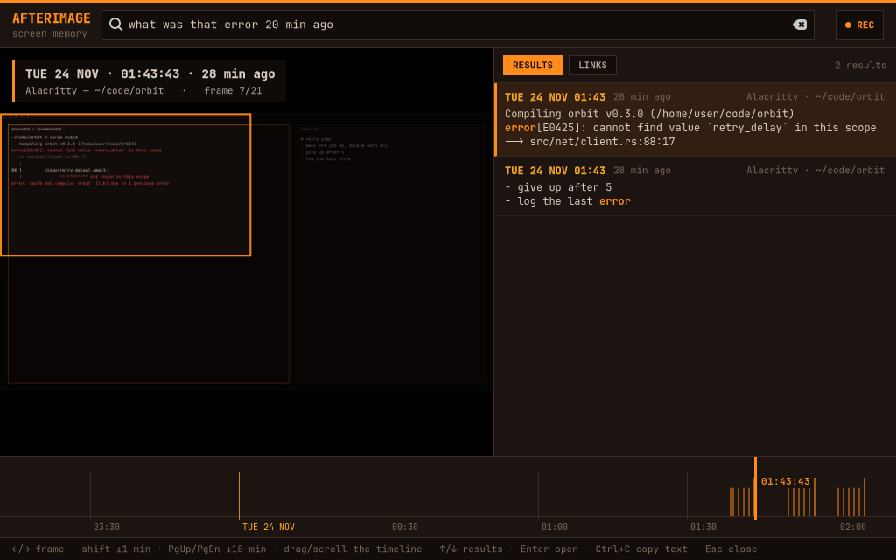

# afterimage

[](https://github.com/Tjabooo/afterimage/actions/workflows/ci.yml) [](https://github.com/Tjabooo/afterimage/releases) [](LICENSE)

A searchable memory of your screen, kept on your own machine: low-fps capture, OCR on a local GPU model,
full-text search ("what was that error 20 min ago", "that link mika sent") and a timeline scrubber.
Old frames delete themselves.



## Features

- **Reads only what changed.** Every 2 s each monitor is grabbed straight from the compositor
  (wlr-screencopy, no screenshots on disk), cut into four overlapping tiles, and only tiles whose
  pixels changed *and settled* (no half-scrolled text) are sent to OCR. An idle desktop costs well under 1% of a CPU core.
- **Local OCR.** Any OpenAI-compatible vision endpoint; made for [npukit](https://github.com/Tjabooo/npukit)'s
  background OCR lane, which runs PaddleOCR-VL 0.9B next to your chat model (~0.35 s per tile on an RX 9070 XT, 1.8 GB VRAM).
- **Questions, not queries.** `error 20 min ago` searches around that time; `link mika` lists links seen next to "mika";
  `app:discord yesterday` limits to one app and one day. Filler words are ignored.
- **Links pulled out.** URLs on screen (chat, terminal, address bar) land in their own list, newest first, one click to open.
- **Timeline scrubber.** Full-screen GTK4 window: frames, an activity timeline you drag and zoom, results with
  the matched words highlighted, and a spotlight on the part of the screen the text was on. Ctrl+C copies the text of a frame.
- **Private by default.** Nothing leaves the machine. Password managers, private browser windows and anything
  with "password" in the title are blacked out before reading or saving. Recording pauses while the screen is locked and
  while a game is open (so the GPU is all the game's), and by hand (`afterimage pause 30m`).
- **Auto-delete.** Frames and text older than `retention_hours` (72) go, and the oldest go first above `max_gb` (20).
- **Cheap storage.** A frame is saved only when the text on screen changed (a ticking clock doesn't count): ~220 KB each.
- **Waybar module** showing ◉ recording / ◌ paused, click to pause.

## Requirements

- Linux with a wlroots-style Wayland compositor (Hyprland, Sway, river…); `grim` is used as a fallback. The
  privacy rules and the game pause read Hyprland's window list; on other compositors only the process rules apply.
- GTK 4.12+, Rust 1.88+ to build.
- An OCR endpoint: [npukit](https://github.com/Tjabooo/npukit) with `backend = "llamacpp"` (its `scripts/get-models.sh`
  fetches PaddleOCR-VL), or any llama.cpp `llama-server` started with a vision OCR model, e.g.
  `llama-server -m PaddleOCR-VL-1.6-GGUF.gguf --mmproj PaddleOCR-VL-1.6-GGUF-mmproj.gguf --port 8080 --temp 0`
  (then set `[ocr] url = "http://127.0.0.1:8080/v1/chat/completions"`).

## Install

```sh
git clone https://github.com/Tjabooo/afterimage && cd afterimage
./install.sh            # builds, installs to ~/.local/share/afterimage, links ~/.local/bin/afterimage, starts the user service
```

`AFTERIMAGE_BINARY=<built binary>` installs a prebuilt binary; `AFTERIMAGE_NO_SERVICE=1` skips enabling the service
(when your session starts its daemons another way). The service is `afterimage.service` (`journalctl --user -u afterimage`).

Hyprland bind (pressing it again closes the window):

```lua
hl.bind("SUPER + SHIFT + R", hl.dsp.exec_cmd(os.getenv("HOME") .. "/.local/bin/afterimage ui"))  -- search screen history
```

Waybar module (set `[bar] signal = 18` in the config so it updates the moment the state changes):

```jsonc
"custom/afterimage": {
  "exec": "cat \"$XDG_RUNTIME_DIR/afterimage/bar.json\" 2>/dev/null || echo '{\"text\":\"\"}'",
  "return-type": "json", "interval": 60, "signal": 18,
  "on-click": "~/.local/bin/afterimage toggle",
  "on-click-right": "~/.local/bin/afterimage ui"
}
```

## Usage

```
afterimage ui [QUERY]             timeline scrubber (with a query: opens on the best hit)
afterimage search QUERY [--json]  "error 20 min ago", "cargo app:alacritty", "yesterday invoice"
afterimage links [QUERY] [--json] links seen on screen, newest first ("links mika")
afterimage pause [DURATION]       stop recording (30m, 2h; default: until resume)
afterimage resume | toggle
afterimage status                 state, frames, disk use
afterimage prune                  apply retention now
afterimage ocr IMAGE.jpg          read one image with the configured OCR model
```

In the scrubber: type to search · ↑/↓ results · Enter jumps (or opens a link) · ←/→ frame by frame ·
Shift+←/→ ±1 min · PgUp/PgDn ±10 min · drag the timeline, scroll to zoom, Shift+scroll to pan ·
Ctrl+Tab next monitor · Ctrl+C copy the frame's text (or the selected link) · Esc clears, then closes.

## Configuration

`~/.config/afterimage/config.toml`; every key is optional. See [`config.example.toml`](config.example.toml) for all of them.

| Key | Default | |
|---|---|---|
| `interval` | `2.0` | seconds between looks |
| `outputs` | `[]` | monitors to record (empty = all) |
| `retention_hours` / `max_gb` | `72` / `20` | auto-delete |
| `min_gap` / `settle` / `max_wait` | `6` / `1` / `20` | how eagerly a changed tile is read |
| `[ocr] url`, `model`, `prompt` | npukit, `"ocr"`, `"OCR:"` | the OCR endpoint |
| `[privacy] exclude_classes`, `exclude_titles` | password managers, private windows | blacked out (regex, case-insensitive) |
| `[privacy] pause_classes` | `cs2`, `steam_app_*`, `gamescope`, Sober | any such window pauses recording |
| `[privacy] pause_processes` | `hyprlock`, `swaylock`, `gtklock` | screen locked |
| `[bar] file`, `signal` | runtime dir, `0` | waybar JSON + RTMIN signal |
| `[ui]` | ember palette | scrubber colours and font |

## How it works

1. **Capture.** wlr-screencopy copies each output into shared memory; windows matching the privacy rules are
   painted black right away, so nothing private reaches OCR or disk.
2. **Change detection.** Each output is cut into a 2×2 grid of overlapping tiles (about 1 megapixel each, the size
   the OCR model reads at full detail). A tile's signature is the mean brightness of its 16×16 blocks; a tile is read
   when its signature moved since the last read, stayed still for one look, and `min_gap` passed.
3. **OCR.** The tile goes as JPEG to the vision endpoint with the prompt `OCR:`; runaway repeats are trimmed.
4. **Index.** SQLite with FTS5: a *span* is what one tile said from when to when, named after the window covering
   most of it. Same text again extends the span; text that differs only in digits (a clock) updates it in place;
   anything else starts a new span and saves a frame. URLs go to a links table.
5. **Search.** The question is split into words (filler words dropped), a relative time ("20 min ago", "yesterday")
   becomes a window, and hits are ranked by how many words they contain, then by closeness to the asked time.
6. **Retention.** Hourly: frames and spans past `retention_hours` are deleted, then the oldest frames above `max_gb`.

## Development

```sh
cargo test && cargo clippy -- -D warnings
AFTERIMAGE_WINDOWED=1600x900 cargo run -- ui    # a plain window instead of full screen
```

## License

MIT
